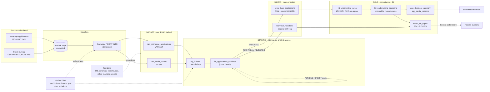

# Architecture

## Layers

| Layer | Schema | Contents | Who can read |
|---|---|---|---|
| Bronze | `BRONZE` | Raw files as received. No casts, so loads never fail on bad data. | loader, transformer |
| Staging | `STAGING` | Typed, de-duplicated views and the join/validation step. Holds raw SSN. | transformer only |
| Silver | `SILVER` | Validated master record + `technical_rejections`. SSN and name carry masking policies. | analyst (masked), compliance (clear) |
| Gold | `GOLD` | Decisions, aggregates, HMDA report. No direct identifiers. | analyst, compliance, auditors (share) |

## Access matrix

| Role | Bronze | Staging | Silver SSN / name | Gold |
|---|---|---|---|---|
| `MORTGAGE_LOADER_ROLE` | write | - | - | - |
| `MORTGAGE_TRANSFORMER_ROLE` | read | write | writes; reads masked | write |
| `MORTGAGE_ANALYST_ROLE` | - | - | masked | read |
| `MORTGAGE_COMPLIANCE_OFFICER_ROLE` | - | - | clear text | read |

## Why STAGING is its own schema
A Snowflake view runs with its owner's privileges. If a view that reads raw Bronze SSNs lived in a
schema analysts can read, the masking policy on Silver would be bypassed. Keeping views over Bronze
in a schema nobody else can see closes that hole.
